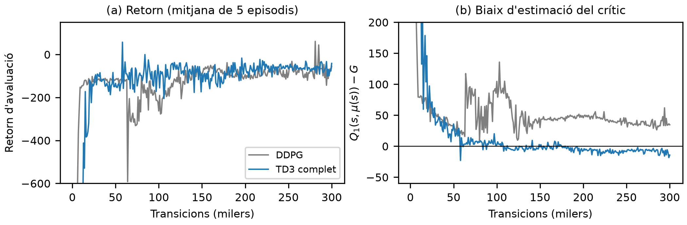

# Implementació de DDPG i TD3 {#sec:impl}

DDPG [@lillicrap2016] aprèn un actor determinista $\mu(s)$ i un crític $Q(s,a)$ a partir d'una memòria de repetició. El crític minimitza l'error quadràtic respecte de l'objectiu $y = r + \gamma(1-d)\,Q'(s',\mu'(s'))$, calculat amb les xarxes objectiu $Q'$ i $\mu'$, i l'actor minimitza $-Q(s,\mu(s))$. Després de cada iteració, les xarxes objectiu s'actualitzen suaument amb el coeficient $\tau = 0{,}001$. A $d$ només hi compta la terminació real (estavellar-se, sortir de la pantalla o quedar en repòs): quan l'episodi es talla pel límit de 1.000 passos, l'objectiu continua fent servir el valor de $s'$, perquè aquest estat no és terminal. Es fa una iteració per pas d'entorn.

Els hiperparàmetres són els de la secció 7 de @lillicrap2016, com demana l'enunciat: Adam amb taxa d'aprenentatge $10^{-4}$ a l'actor i $10^{-3}$ al crític, *weight decay* de $10^{-2}$ al crític, lots de 64, memòria de $10^6$ transicions i factor de descompte $\gamma = 0{,}99$. Les xarxes són les de l'esquelet, sense modificar (400 i 300 unitats amb LayerNorm). El constructor del crític no crida la inicialització de l'article i la cridem explícitament. DDPG explora amb el soroll d'Ornstein-Uhlenbeck (OU) de `Noise.py` amb els paràmetres per defecte ($\theta = 0{,}2$, $\sigma = 0{,}15$, $dt = 0{,}01$; l'article usa $\theta = 0{,}15$ i $\sigma = 0{,}2$), reiniciat a cada episodi.

TD3 [@fujimoto2018] és una còpia de DDPG amb tres canvis. (i) Suavitzat de la política objectiu: $\tilde a' = \mathrm{clip}(\mu'(s') + \mathrm{clip}(\epsilon,-0{,}5,0{,}5),-1,1)$ amb $\epsilon \sim \mathcal{N}(0,\,0{,}2^2)$. (ii) Dos crítics entrenats cap al mateix objectiu $y = r + \gamma(1-d)\min_{i=1,2} Q'_i(s',\tilde a')$; l'actor maximitza $Q_1$. (iii) L'actor i les tres xarxes objectiu s'actualitzen cada dues iteracions dels crítics. Es mantenen $\tau$, les xarxes i els optimitzadors, inclòs el *weight decay* dels dos crítics. L'exploració és gaussiana, $\mathcal{N}(0,\,0{,}1^2)$, el valor de l'article de TD3, perquè l'enunciat no en fixa cap.

Tres interruptors (`use_minimum`, `target_noise` i `policy_delay`) defineixen les variants de l'ablació sense canviar res més. *Sense mínim* fa servir $Q'_1$ a l'objectiu però continua entrenant els dos crítics, *sense suavitzat* posa $\sigma_\text{targ} = 0$ i *sense retard* actualitza l'actor i les xarxes objectiu a cada iteració. El soroll de l'objectiu se sorteja sempre, també amb $\sigma_\text{targ} = 0$: així, amb la mateixa llavor, totes les variants parteixen dels mateixos pesos i consumeixen la mateixa seqüència aleatòria. Proves automàtiques comproven aquestes propietats.

# Protocol experimental {#sec:protocol}

Totes les execucions tenen el pressupost que fixa l'enunciat, $T = 300.000$ transicions, declarat abans d'executar res. DDPG i TD3 complet es comparen amb una llavor (la 0), com demana l'enunciat. A l'ablació, cada variant s'entrena amb les llavors 0–9: l'enunciat en demana de 3 a 5, però la variància entre llavors és alta i vam preferir-ne deu. TD3 complet desa el *checkpoint* que demana l'enunciat a la primera frontera d'episodi a partir de $T/3$, però totes les variants s'entrenen des de zero, sense compartir el primer terç.

Cada 1.000 transicions s'avalua la política sense soroll en 5 episodis amb les mateixes llavors d'entorn (10000–10004) a totes les avaluacions. Abans de veure cap resultat vam fixar dues mètriques: la mitjana de les últimes 10 avaluacions (L10, 50 episodis) i l'àrea sota la corba d'avaluació dividida per $T$ (AUC/T). Es dona la mitjana entre llavors amb la desviació estàndard. Les diferències respecte de TD3 complet s'aparellen per llavor, amb un interval de confiança (IC) del 95 % per *bootstrap* (10.000 remostrejos). Com a anàlisi complementària, no fixada d'entrada, s'hi afegeix un test de permutació aparellat exacte amb correcció de Holm per a les tres comparacions. També es mesuren la fracció d'episodis amb retorn $\geq 200$, el llindar amb què es considera resolt l'entorn [@gymnasium], i la fracció d'avaluacions amb els cinc episodis truncats.

El biaix del crític es mesura com a $Q_1(s_t,\mu(s_t)) - G_t$, on $G_t = \sum_k \gamma^k r_{t+k}$ és el retorn descomptat observat en els episodis d'avaluació. En els episodis truncats s'exclouen els estats amb menys de 300 passos per davant, perquè el seu $G_t$ queda incomplet. Les execucions es van fer en CPU, en dues màquines virtuals Azure Standard_D4s_v4 repartides per llavors, perquè una diferència entre màquines no es confongués amb l'efecte d'una variant. Cada execució de TD3 va trigar unes 6,8 h.

# Comparació exploratòria DDPG–TD3 {#sec:ddpg}

{#fig:ddpg width=100%}

A la Figura @fig:ddpg, totes dues execucions surten del retorn inicial d'uns −1.440 en poques avaluacions (DDPG supera −200 als 9.000 passos i TD3 als 15.000) i acaben en un nivell semblant: L10 de −83,6 per a DDPG i de −70,3 per a TD3. La diferència clara és al crític: al final, el de DDPG sobreestima el retorn en 40,2 punts de mitjana, mentre que el primer crític de TD3 queda lleugerament per sota ($-10{,}6$), que és la direcció que motiva TD3 [@fujimoto2018]. Amb una sola llavor per algorisme i dos sorolls d'exploració diferents, aquesta comparació no és evidència d'una diferència de rendiment.

# Estudi d'ablació: resultats {#sec:resultats}

{#fig:ablacio width=100%}

| Variant | L10 | AUC/T | Δ L10 [IC 95 %] | $p$ Holm | Resolts | Truncades | Biaix |
|---|---|---|---|---|---|---|---|
| TD3 complet | −51,3 ± 45,9 | −115,2 ± 43,5 | — | — | 2,0 % | 65 % | −6,4 ± 7,5 |
| Sense mínim | 55,4 ± 110,1 | −45,8 ± 67,0 | +106,6 [27,5, 177,6] | 0,088 | 27,6 % | 25 % | +32,2 ± 18,2 |
| Sense suavitzat | −54,6 ± 95,1 | −95,6 ± 48,4 | −3,4 [−51,1, 55,1] | 0,902 | 7,0 % | 70 % | −2,2 ± 13,3 |
| Sense retard | 19,7 ± 110,5 | −86,8 ± 45,3 | +70,9 [11,2, 142,7] | 0,152 | 17,8 % | 57 % | −14,4 ± 11,5 |

: Ablació, 10 llavors per variant (mitjana ± desviació estàndard). Δ L10: diferència aparellada respecte de TD3 complet; $p$ Holm: test de permutació aparellat exacte amb correcció de Holm. Sobre les últimes 10 avaluacions: Resolts, episodis amb retorn ≥ 200; Truncades, avaluacions amb els cinc episodis truncats a 1.000 passos; Biaix, $Q_1(s,\mu(s))-G$. {#tbl:ablacio}

Cap variant arriba al llindar de 200 en mitjana, i les corbes de retorn de sense mínim i sense retard encara pugen als 300.000 passos, mentre que la de TD3 complet és gairebé plana des dels 250.000 (Figura @fig:ablacio a). La variant sense mínim obté la L10 i l'AUC/T més altes (Taula @tbl:ablacio) i supera TD3 complet en 8 de les 10 llavors, amb $p = 0{,}029$ sense corregir i $p = 0{,}088$ amb Holm. La variant sense retard també millora la mitjana en 8 de 10 llavors ($p = 0{,}152$ amb Holm), però la seva mediana (−27,7) queda molt per sota de la mitjana (19,7) perquè dues llavors, amb una L10 de 239,8 i 184,7, concentren la millora. Sense suavitzat, en canvi, no es distingeix de TD3 complet, i amb la correcció de Holm cap diferència és significativa al 5 %.

La fracció d'episodis resolts separa més les variants (Figura @fig:ablacio b). Cap llavor de TD3 complet arriba a resoldre el 50 % dels episodis, i quatre de sense mínim hi arriben o el superen. La diferència es manté en les cinc condicions inicials d'avaluació: sense mínim en resol entre el 21 % i el 33 % de cada condició, i TD3 complet entre el 0 % i el 5 %. A canvi, sense mínim és la variant més inestable, amb 73 caigudes de més de 200 punts entre avaluacions consecutives després dels 50.000 passos, per 17 de TD3 complet.

El biaix final (Figura @fig:ablacio c) és proper a zero o negatiu a les tres variants que conserven el mínim. L'única que sobreestima és sense mínim, amb un valor proper al de DDPG (secció @sec:ddpg). Dins de cada variant, les llavors amb més biaix tendeixen a acabar amb menys retorn: la correlació de Spearman entre el biaix i la L10 va de −0,24 a −0,72 segons la variant (10 llavors cadascuna).

# Discussió {#sec:discussio}

## El planeig {#sec:planeig}

A TD3 complet, el 65 % de les últimes avaluacions tenen els cinc episodis truncats als 1.000 passos (Taula @tbl:ablacio): el mòdul no s'estavella ni arriba a repòs. Les xarxes finals de l'estudi principal no es van desar, i el comportament concret el vam mesurar amb les de la prova de control (secció @sec:control), en 20 episodis per a cadascuna de les seves 10 execucions. Dels 200 episodis, 143 es van truncar. En els seus últims 200 passos, el mòdul era per sobre del terra en el 88 % dels casos (*y* normalitzada de 0,38 de mitjana, on 0 és l'alçada de la plataforma). Les dues potes tocaven terra l'1,6 % del temps, la velocitat vertical era de 0,021 i el motor principal estava encès en el 73 % dels passos.

La recompensa de LunarLander fa que aquest comportament sigui estable [@gymnasium]. Cada pas amb el motor principal encès costa fins a 0,3 punts, i planejar fins al límit acaba en un retorn moderadament negatiu (−42,4 de mitjana en aquests episodis), mentre que un aterratge fallit suma −100. Aterrar dona +100, però abans cal passar per estats propers al terra en què una acció dolenta porta al xoc. Si aquests estats apareixen poc a la memòria de repetició i el crític els valora malament, és d'esperar que l'actor, que segueix el gradient de $Q_1$, es quedi planejant. Les dades no permeten verificar aquest mecanisme directament.

## Què canvia cada mecanisme {#sec:mecanismes}

A l'ablació, treure el mínim fa aparèixer la sobreestimació (de −6,4 a +32,2) i és el canvi que més millora el retorn, tot i que la diferència no supera la correcció de Holm. Seria temptador concloure que el pessimisme del mínim provoca el planeig, però les dades no ho sostenen. Dins de cada variant, més biaix tendeix a anar amb menys retorn: la llavor 3 de sense mínim, per exemple, és la que més episodis resol (76 %) i té un biaix de 0,1. A més, amb les llavors 0–4, treure el *weight decay* també fa sobreestimar en les cinc llavors (mediana +10,0; la mitjana, +26,1, la puja una llavor amb +91,3). Tot i així, només resol el 6,8 % dels episodis, davant el 28,4 % de sense mínim (Taula @tbl:control). L'efecte del mínim sobre l'aterratge, per tant, no sembla explicar-se pel nivell mitjà del biaix; que depengui del valor que assigna a estats concrets, com els propers al terra, és una hipòtesi que no hem comprovat.

El suavitzat no té cap efecte clar, ni en el retorn ni en el biaix (−2,2 davant −6,4). Treure el retard duplica les actualitzacions de l'actor (299.936 en lloc de 149.968) i allarga cada execució un 18 % (8,0 h davant 6,8 h). El seu biaix tendeix a ser més negatiu, sense contrast que ho confirmi, i la millora de la mitjana depèn de dues llavors.

## Prova de control {#sec:control}

Com que TD3 complet no aterra, vam comprovar que no fos per un error d'implementació amb una prova fora del protocol, amb les llavors 0–4 i les xarxes finals desades. La configuració *td3_paper* aplica a les xarxes de l'esquelet els hiperparàmetres de la taula 3 de @fujimoto2018. Són $\tau = 0{,}005$, una taxa d'aprenentatge de $10^{-3}$ a l'actor i als crítics, cap *weight decay*, lots de 100 i 10.000 passos inicials d'accions uniformes sense aprendre. *Sense weight decay* només treu el *weight decay* dels crítics. Cada execució s'avalua també al final, en 100 episodis amb llavors noves.

| Configuració | L10 | AUC/T | Resolts | Truncades | Biaix | Final: retorn | Final: resolts | Final: truncats |
|---|---|---|---|---|---|---|---|---|
| TD3 complet | −64,4 | −129,2 | 0,0 % | 66 % | −4,5 | — | — | — |
| Sense mínim | 55,9 | −65,4 | 28,4 % | 26 % | +24,3 | — | — | — |
| td3_paper | 67,8 | −31,6 | 29,2 % | 48 % | −12,2 | 64,3 | 26,8 % | 65,2 % |
| Sense *weight decay* | −47,7 | −80,2 | 6,8 % | 62 % | +26,1 | −53,4 | 6,4 % | 79,8 % |

: Prova de control fora del protocol, llavors 0–4 (mitjana entre llavors); columnes L10 a Biaix com a la Taula @tbl:ablacio. TD3 complet i sense mínim provenen de l'estudi principal i no tenen avaluació final. Final: política final en 100 episodis amb llavors noves; truncats: episodis que arriben als 1.000 passos. {#tbl:control}

Amb td3_paper, la llavor 3 resol l'entorn: 269,7 punts de mitjana a l'avaluació final i el 98 % d'episodis resolts. La implementació, doncs, pot aprendre a aterrar. Les llavors 0, 2 i 4, en canvi, continuen planejant (entre el 83 % i el 100 % d'episodis truncats a l'avaluació final), de manera que el planeig no depèn només dels hiperparàmetres de l'enunciat. Treure el *weight decay* fa pujar el biaix en les cinc llavors: el *weight decay* contribueix a la lleugera infraestimació de TD3 complet, però treure'l no redueix el planeig. L'avaluació final és del mateix ordre que la L10 a cada llavor (per exemple, 269,7 davant 274,0 i 87,6 davant 102,8), cosa que suggereix que les cinc condicions inicials fixes de l'avaluació periòdica no en distorsionen gaire el resultat. Amb cinc parells, el test exacte no pot donar $p < 0{,}0625$, i aquesta prova és un diagnòstic, no un contrast d'hipòtesis.

## Limitacions {#sec:limitacions}

Amb més llavors o més pressupost les conclusions de l'ablació podrien canviar, perquè cap diferència supera la correcció de Holm i dues corbes encara pugen a $T$. La comparació DDPG–TD3 té les limitacions de la secció @sec:ddpg. Part de la configuració ve de l'esquelet: LayerNorm (l'enunciat parla de *batch normalization*), una inicialització que usa el nombre de sortides de cada capa en lloc del d'entrades i el *weight decay* als crítics de TD3, que l'article de TD3 no fa servir. El biaix es mesura sobre els estats de cada política i per a $\mu$, mentre que el crític aprèn el valor de la política suavitzada.

# Conclusions {#sec:conclusions}

A l'ablació, treure el mínim fa aparèixer una sobreestimació semblant a la de DDPG. Amb els hiperparàmetres fixats i $T = 300.000$, cap variant resol LunarLander en mitjana: en tres de les quatre, més de la meitat de les últimes avaluacions tenen els cinc episodis truncats, i a les xarxes de la prova de control el mòdul hi planeja. Treure el mínim tendeix a millorar el retorn i els episodis resolts, sense significació amb deu llavors; el suavitzat i el retard no tenen cap efecte clar. La implementació pot resoldre l'entorn, i el planeig persisteix amb els hiperparàmetres de l'article de TD3. El pas següent seria mesurar el biaix en els estats propers al terra, per entendre per què el mínim afecta l'aterratge.
